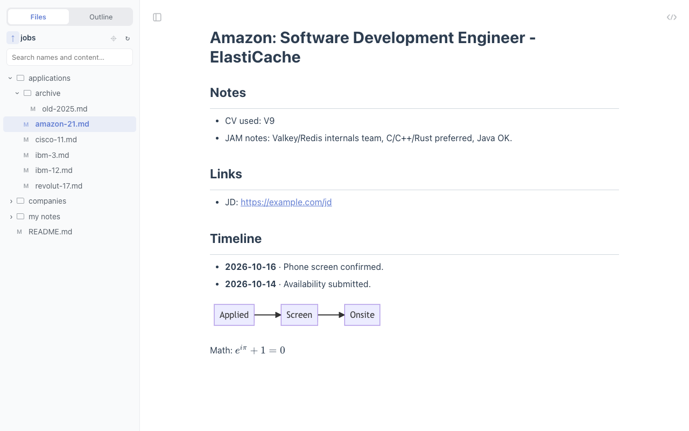

# MD Reader+ (folders)

A personal fork of the MIT-licensed [md-reader](https://github.com/md-reader/md-reader) Chrome extension. It adds the folder
sidebar that the store version sells as Pro. Everything else (rendering, KaTeX, Mermaid, Graphviz, themes, outline, auto-refresh,
shortcuts) is unchanged from upstream.



## What's here

| Path                                                                                           | What                                                                 |
| ---------------------------------------------------------------------------------------------- | -------------------------------------------------------------------- |
| [`docs/fork/FEASIBILITY.md`](docs/fork/FEASIBILITY.md)                                         | Analysis: self-build vs. alternatives, and why we forked md-reader   |
| [`src/core/dir-listing.ts`](src/core/dir-listing.ts), [`src/side/files.ts`](src/side/files.ts) | The new code: listing parser, tree and search                        |
| `extension/`                                                                                   | **Built extension (after `pnpm build`): load this folder in Chrome** |
| [`e2e/`](e2e/)                                                                                 | Playwright end-to-end test + sample `jobs/` fixture                  |
| [`docs/fork/screenshots/`](docs/fork/screenshots/)                                             | Output of the e2e run                                                |

Remotes: `origin` = your fork, `upstream` = md-reader/md-reader. Pull upstream with
`git fetch upstream && git merge upstream/main`.

## Install (once)

1. Open `chrome://extensions`, turn on **Developer mode** (top right).
2. **Load unpacked** → pick `~/Workspace/projects/md-reader-plus/extension` (run `pnpm install && pnpm build` first on a fresh clone).
3. Open the new extension's **Details** → turn on **Allow access to file URLs**.
4. **Turn off the store md-reader** (both would render the same `.md` page).
5. Open any local `.md` file, e.g. `file:///Users/akpmohan/Workspace/dsa-practice-java/jobs/applications/amazon-21.md`.

After pulling changes: `pnpm build`, then click ↻ on the extension card.

## Features added

- **Files / Outline tabs** in the sidebar (Files appears only for `file://` pages; the choice is remembered).
- **Folder tree** of the current file's folder: folders load when you expand them, only `.md/.mdx/.mkd/.markdown` files are shown,
  dotfolders and `node_modules` are hidden, names sort naturally (`ibm-3` before `ibm-12`), and the current file is highlighted.
- **Root control:** ↑ shows the parent folder, double-click a folder to make it the root, ⌖ goes back to the file's own folder.
  The chosen root is remembered for every file under it, so open `jobs/` once and it stays the root.
- **Expanded folders remembered** across pages and reloads.
- **Search** over the whole tree: filename matches appear instantly, and content matches show up to 3 highlighted lines per file.
  Enter opens the first hit, Esc clears.
- **Refresh:** ↻ button, plus an automatic re-read when you come back to the tab (new files appear).
- Works with light/dark themes. The sidebar collapse shortcut (Alt+Shift+B) and raw toggle work as before.

## How it works

The MV3 background worker already `fetch()`es `file://` URLs for auto-refresh. A `file://…/folder/` URL returns Chrome's
directory-listing page, made of `addRow("name","url",isDir,size,…)` entries. `src/core/dir-listing.ts` parses those entries and
`src/side/files.ts` renders the tree and search. No local server, no folder picker, no network.

Changed upstream files are kept small so `git merge upstream/main` stays easy:
`background.ts` (+`listDir`/`fetchText`, file:// only), `main.ts` (tab wiring), `class-name.ts`, `index.less`, locale names.

## Tests

```bash
pnpm test                             # unit tests: listing parser + upstream graphviz
cd e2e && npm i && npx playwright install chromium && npm run e2e   # real Chromium, 8 steps, writes docs/fork/screenshots/
```

## Limits

- `file://` only. Online `.md` URLs get the normal outline sidebar.
- Search reads up to 1,000 files (3,000 listed, 8 levels deep). That's plenty for notes folders, but don't root it at `~`.
- Relies on Chrome's internal directory-listing format, which has been stable for years but isn't an official API. The parser is
  isolated and unit-tested, so a breakage would be quick to spot and fix.
- Don't publish this to the Web Store under the md-reader name or logo. MIT covers the code, not the branding.
