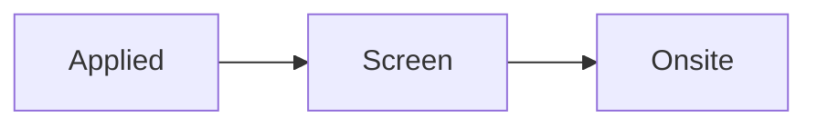

# Amazon: Software Development Engineer - ElastiCache

## Notes

- CV used: V9
- JAM notes: Valkey/Redis internals team, C/C++/Rust preferred, Java OK.

## Links

- JD: https://example.com/jd

## Timeline

- **2026-10-16** · Phone screen confirmed.
- **2026-10-14** · Availability submitted.

Math: $e^{i\pi}+1=0$
